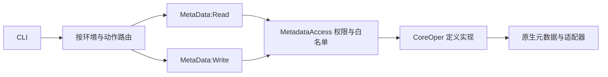

# 架构与交付边界

使用 CLI 先看 [SKILL.md](../SKILL.md)；安装、授权、URI 和原生迁移命令见 [安装说明](01-auth-api.md)。本文件说明当前结构及维护时必须一起更新的部分。

## 工程与应用包

维护边界按开发与运行管理划分。ps-cli 维护 AD 开发定义，包括 Field 的 XLAT、页面/组件、程序及 AE 结构；角色、许可权、用户授权、Process Definition、进程组、Scheduler 日常配置归后续独立 ps-admin。工具自身预置的两套安装许可权及配套角色属于 ps-cli 交付，不增加通用安全管理 API。许可权可随 AD Project 迁移，角色使用原生配套交付，用户成员不随包迁移。既有 IB/门户配置入口本轮不删除，API 授权校验与运行验收的前置配置检查保留；AE 程序开发与进程调度管理分开。

`C_META_DATA_PKG` 有两个含义：AD Project 是完整部署清单；同名应用根包只承载元数据处理和公共实现。不能只导入同名应用包来代替完整工程。

| 应用根包 | 职责与归属 |
|---|---|
| `C_META_DATA_PKG` | `MetaData:Read` / `MetaData:Write` 为服务入口；`Utility:CoreOper*` 为共享定义实现，另有版本、权限、原生键与保存/删除适配器 |
| `C_COMMONS_PKG` | 工程包含 `CommonUtil`、`HttpClient:HttpUtil`、`Login:Login`、`JavaReflect` 等所需类；该根包的其他业务类不因此自动进入工具交付 |
| `C_JSON_API` | 接口、Factory、Scalar、JsonUtil 及 NativeApi / CustomApi / JavaApi 三个实现，共 30 类作为运行依赖交付；旧 Core 转发的 7 类及包节点归 JSON 自身工程 |
| `C_SPREADSHEET` | 独立电子表格工程，不属于 MetaData 部署包；25 类及包节点仍由 C_SPREADSHEET 工程管理，与 JSON 共用 JavaReflect |
| `C_PORTAL_PKG` | 独立门户业务包，不在核心工程内；保留 GetMenu 及其旧 JsonUtil，不改其原生 JsonObject 签名 |
| `C_DEMO` | 演示和测试包，不属于核心部署工程；MetaDataTest 子包保存迁出的 Demo、REST/SOAP Handler 及空测试类壳 |

工程还包含服务/操作、URI、Handler/Routing、SQL 定义及实际使用的自定义 Record/Field，包括 `C_AI_SQLAUD` 审计记录。只引用未修改的标准 Field 不单独列入 Project；当前仅保留自定义 `C_AE_ACTN_TYPE` 的 Field 成员，审计记录使用的 8 个系统 Field 由目标系统已有定义提供。消息翻译复用系统组件 `MESSAGE_CATALOG1` 及标准 `MESSAGE_CATALOG_CI`；不复制系统定义，也不包含原自建 `C_META_MSG_LANG` 页面/组件/CI/程序。包清单中的 Copy / Delete 条目都具有迁移意义，不将 Delete 键视为垃圾删除。

## 请求入口

- Read Service 为 `C_META_DATA_READ`，Write Service 为 `C_META_DATA_WRITE`。16 类定义各有独立 `AI_READ_*` 操作，原 `AI_OPER_*` 名称保留为写操作；两组均使用 POST。
- 搜索、列表、业务数据查询及 SQL 查询属于 Read，SQL DML 属于 Write 且单独授权。`PSTOKEN_GET` 的 Handler 是 `C_COMMONS_PKG:Login:Login`。
- `scripts/metadata_routing.py` 决定 split 环境的 CLI 查询路由；服务端入口再次校验动作白名单和当前用户实际权限。CoreOper* 不能直接绑定成 Handler。
- 未迁移环境保留 legacy；split 的权限/部署失败不自动回退。新增动作同步入口白名单和 CLI 路由；新增对象同步两组操作、权限文档、健康探测及完整工程。

## 公共依赖

JSON 经 Factory 选择实现：AUTO 在目标编译版本低于 8.55.11 时选 CustomApi，其余选 NativeApi；JavaApi 需要显式选择并配置兼容的 org.json。Core 兼容名称保留在 JSON 自身工程，不由 MetaData 引用或交付。原生 JSON 引用集中在带版本编译保护的 NativeApi:JSONStorage；不能据 Factory 选择机制声明整个 CLI 已跨版本认证。

JSON 和独立的电子表格工程共同使用 `C_COMMONS_PKG:JavaReflect` 反射创建 Java 对象/数组，按明确签名装箱，调用成功和异常都清理参数引用；热路径不重新引入直接 CreateJavaObject / CreateJavaArray。第三方 jar、资源 close/dispose 和目标 JVM/POI 兼容性仍需单独处理。配置及示例见 [JSON 兼容层](01-auth-api.md#json-兼容层2026-10-30) 和 [Java 反射工具](01-auth-api.md#公共java反射工具)。

## 消息目录翻译

新增/修改通过会话 RegionalSettings.LanguageCd 指定事务语言后调用标准 MESSAGE_CATALOG_CI；成功、校验失败和异常均恢复原语言。标准 DeleteMessage 会删除基准及所有翻译，不能用于单语言删除。精确删除在标准 CI Save 权限检查通过后，按 PSMSGCATLANG 全部键使用原生 Record.Delete，并调用交付的 PPC 缓存版本函数。显式翻译与基准内容完全相同时，标准 CI 可能不插入语言行，使用同样受保护的精确 Record.Insert 保留 API 的 translationExists 语义。

原始 expectedVersion、消息集锁、单事务、dry-run、占位符校验和失败回滚继续适用。原 C_META_MSG_LANG 四项定义仅在辅助工程保留，不再是运行依赖。实测及限制见 [消息目录](15-message-catalog-api.md#独立翻译)。

## 版本和删除边界

定义写入依赖读取时的原始 expectedVersion；428/409 保留改稿，不在保存前换基线。源码工作副本不是历史版本库。不同定义的版本范围、事务边界和原生删除单位以各对象参考为准。

门户解耦的迁移顺序为完整核心工程 → 辅助工程 `C_PORTAL_MOVE_261030` → 核对 PSTOKEN_GET 新绑定。辅助工程的父包 57/Copy 与类 58/Delete 需一起保留；不混入核心工程。详见 [门户包解耦](01-auth-api.md#门户包解耦2026-10-30)。现有导出检查不能证明目标环境已实际删除旧定义。

## 维护与交付

1. 在开发项目维护 PeopleCode 源码，通过 API 或 AD 编译保存；正在执行的 OperAppPackage 禁止通过自身接口改写/删除，只能用 AD。
2. 修改服务端后，使用 AD 原生 Copy To File 导出完整 Project，保留 XML/INI、依赖和新编译内容；不能只替换 XML 正文或沿用旧编译块。
3. 开发项目的 `tools/check_bundle.py` 检查清单、编译内容、Handler 和自定义依赖闭包。当前核心包含 `100` 个运行类及其编译程序，检查器同时拒绝未分类类、测试/演示/电子表格及退役翻译定义；基本 healthcheck 的 `20` 个读取操作与工程内全部 `38` 个操作也是不同口径。
4. `tools/sync_skill.py` 将共享维护源单向同步至 release 镜像和已安装副本。只在形成新的验收包时升版本并打包，不用同名 zip 覆盖历史验收产物。

本机开发目录、证据索引和当前数量以开发项目的 README / 当前状态页为入口；历史轮次报告仅证明当时的基线。正式交付条件见 [发布规划](release-roadmap.md)，未验证和延期项见 [已知问题](known-code-issues.md)。
